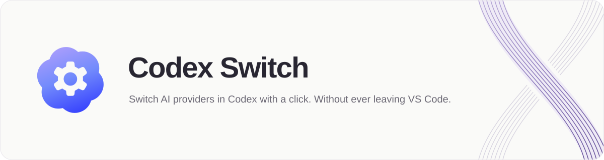

  

A minimal VS Code sidebar extension for switching the model provider used by
Codex. The sidebar shows the current provider and the actions for ChatGPT and
DeepSeek, with persistent provider visibility and ordering controls. API keys
stay encrypted locally; API usage is billed separately.

| Provider | Access | Integrated models |
| --- | --- | --- |
| ChatGPT | Existing ChatGPT subscription and sign-in | Models available to your account |
| DeepSeek | DeepSeek API key | `deepseek-flash`, `deepseek-v4-pro` |

Open **Codex Switch** from the rosette-and-gear icon in the Activity Bar. Use
**Update model catalog** to refresh DeepSeek's model list. History and tools may vary
between providers. Switching providers reloads VS Code automatically. Requires
Windows and Python 3.11+ on `PATH`.

| Version | Changes |
| --- | --- |
| 0.1.9 | Reload VS Code automatically after a provider switch succeeds. |
| 0.1.8 | Apply the saved provider filter and order before revealing the Provider section, preventing the full list from flashing during window reload. |
| 0.1.7 | Keep provider visibility changes responsive and ordered, and keep the active provider visible and locked against deselection. |
| 0.1.6 | Auto-hide action feedback after 3 seconds without an icon, add a close control and full provider labels to Manage Providers, and make provider visibility and ordering reliable. |
| 0.1.5 | Show provider subtitles in the current configuration, manage provider visibility and order, restore the native API key dialog with status feedback, highlight the active card, and add colored action results. |
| 0.1.4 | Simplify the English sidebar to the current provider, ChatGPT and DeepSeek actions, a fixed DeepSeek model list, and a masked API key field. |
| 0.1.3 | Require installation and verification in the current VS Code window before submitting changes for review. |
| [0.1.2](https://github.com/macorisd/codex-switch/releases/tag/v0.1.2) | Add the supplied logo, README banner and sidebar icon; publish VSIX release assets and link release history automatically. |
| [0.1.1](https://github.com/macorisd/codex-switch/releases/tag/v0.1.1) | Move source into this repository, bundle the local connector with the extension, and document project conventions. |
| 0.1.0 | Initial sidebar selector for ChatGPT and DeepSeek, model and reasoning selection, encrypted API key storage, and connection checks. |

Development

Run `npm test` to check the extension and backend. Run `npm run package` to
generate a VSIX, then install it with `code --install-extension <file.vsix>`.
Runtime data stays in `%USERPROFILE%\.codex\provider-switcher`, outside the
repository. Project conventions: [docs/decisions](docs/decisions/README.md).

